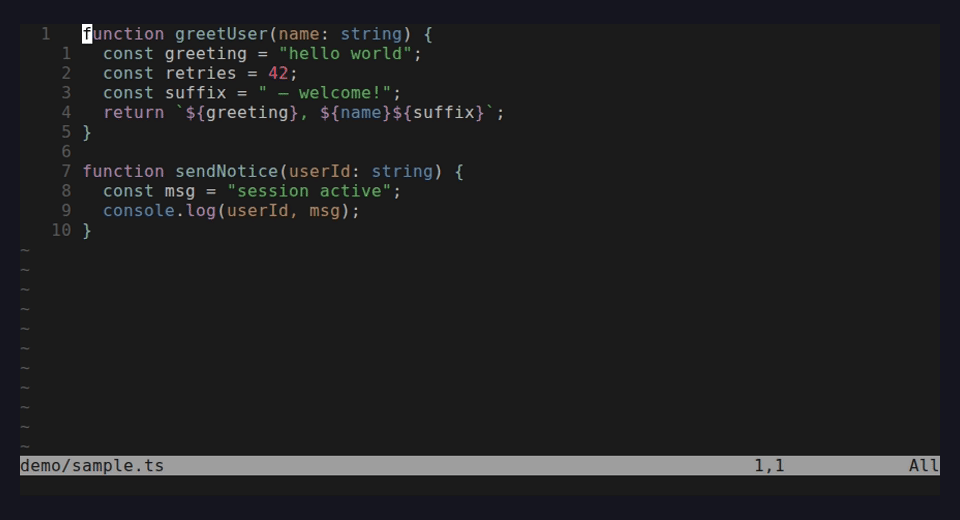

# vimcoach

Watches how you edit and shows you shorter Vim motions for what you just did. Works in Neovim and VS Code (both `vscode-neovim` and `VSCodeVim`).



`vimcoach` looks at your buffer, cursor jumps, and before/after edits rather than just counting repeated keys. It sticks to practical motions you'd actually use (won't nag `jjj` or suggest `4fe`), ignores pauses while you're reading, and tracks your habits in a dashboard.

A few things it catches:

- Text objects instead of visual stepping (`vllllld` → `di"`, `vwwc` → `ci(`, `vi"d` → `di"`)
- Direct jumps instead of walking (`0`/`^`/`$`, `%`, `f`/`t`, `{`/`}`, `gg`/`G`, `<C-d>`/`<C-u>`, `<C-o>`)
- Shorter editing combos (`d$` → `D`, `dw`+`i` → `cw`, `dd`+`O` → `cc`, `^i` → `I`, `A<CR>` → `o`, `~`, `<C-a>`, `J`)
- Repetition and search (`.`, `*`/`#`, `cgn`)
- Insert mode habits (mashing `<BS>` → `<C-w>`/`<C-u>`, arrow keys)

## Install

### Neovim & `vscode-neovim`

With `lazy.nvim`:

```lua
return { "monroedean/vimcoach" }
```

No `setup()` call needed unless you want to change the defaults. In VS Code with `vscode-neovim`, hints show up inline at the end of the line (hover for details) and briefly in the status bar.

### VS Code with `VSCodeVim`

Because `VSCodeVim` doesn't load Lua plugins, there's a companion VS Code extension in [`vscode-extension/`](vscode-extension/README.md). Grab it from the [VS Code Marketplace](https://marketplace.visualstudio.com/items?itemName=monroedean.vimcoach) (or [Open VSX](https://open-vsx.org/extension/monroedean/vimcoach) for Cursor/VSCodium):

```bash
code --install-extension monroedean.vimcoach
```

It picks up `vscodevim.vim` automatically and stays quiet if you're using `vscode-neovim` instead. Hints show up inline and in the status bar, with a dashboard in the sidebar. If you'd rather install manually, grab the `.vsix` from [Releases](https://github.com/monroedean/vimcoach/releases) or build it from `vscode-extension/`.

## Commands

| Command | Action |
| --- | --- |
| `:VimCoach` | Open the stats dashboard |
| `:VimCoachToggle` | Pause or resume |
| `:VimCoachStrict` | Toggle strict mode (blocks key spamming) |
| `:VimCoach coach\|strict\|adaptive` | Switch mode |
| `:VimCoach status` | Print a quick summary |
| `:VimCoach test` | Trigger a sample hint |
| `:VimCoachReset` | Clear saved stats |

Statusline helper (e.g. for `lualine.nvim`):

```lua
function() return require("vimcoach").statusline() end
```

## Config

Defaults live in [lua/vimcoach/config.lua](lua/vimcoach/config.lua). Override only what you want:

```lua
require("vimcoach").setup({
  mode = "coach",         -- "coach" | "strict" | "adaptive"
  practical_only = true,
  disabled_rules = {},    -- e.g. { nav_vertical_count = true }
  ui = {
    style = "float",        -- "float" | "notify" | "echo"
    position = "top_right", -- "top_right" | "bottom_right" | "cursor"
    duration_ms = 4500,
  },
  vscode = {
    style = "inline_and_status",
  },
})
```
