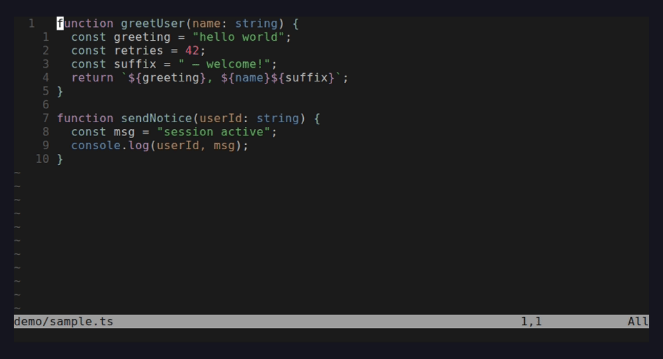

# vimcoach (for VSCodeVim)

Watches how you edit in `VSCodeVim` and shows you shorter Vim motions for what you just did.

`vimcoach` looks at your buffer, cursor jumps, and before/after edits rather than just counting repeated keys. It sticks to practical motions you'd actually use (won't nag `jjj` or suggest `4fe`), ignores pauses while you're reading, and tracks your habits in a sidebar dashboard.

A few things it catches:

- Text objects instead of visual stepping (`vllllld` → `di"`, `vwwc` → `ci(`, `vi"d` → `di"`)
- Direct jumps instead of walking (`0`/`^`/`$`, `%`, `f`/`t`, `{`/`}`, `gg`/`G`, `<C-d>`/`<C-u>`, `<C-o>`)
- Shorter editing combos (`d$` → `D`, `dw`+`i` → `cw`, `dd`+`O` → `cc`, `^i` → `I`, `A<CR>` → `o`, `~`, `<C-a>`, `J`)
- Repetition and search (`.`, `*`/`#`, `cgn`)
- Insert mode habits (mashing `<BS>` → `<C-w>`/`<C-u>`, arrow keys)

## Requirements

- [VSCodeVim](https://marketplace.visualstudio.com/items?itemName=vscodevim.vim) (`vscodevim.vim`) installed and enabled.

Hints show up inline at the end of the line (hover for details) and briefly in the status bar, without overriding `VSCodeVim`'s keybindings. If you use `vscode-neovim` instead, this extension stays quiet; use the Neovim plugin from [monroedean/vimcoach](https://github.com/monroedean/vimcoach) directly.

## Commands

Open the Command Palette (`Cmd+Shift+P` / `Ctrl+Shift+P`), click the status bar item, or open the sidebar icon:

| Command | Action |
| --- | --- |
| `VimCoach: Open Mastery Dashboard` | Open the sidebar dashboard |
| `VimCoach: Toggle Enable/Disable` | Pause or resume |
| `VimCoach: Cycle Mode (Coach / Adaptive / Strict)` | Switch between `coach`, `adaptive`, and `strict` |
| `VimCoach: Set Mode` | Pick a mode directly |
| `VimCoach: Show Status` | Print a quick summary |
| `VimCoach: Trigger Sample Hint` | Preview the inline and status bar hint |
| `VimCoach: Reset Stats` | Clear saved stats |

## Settings

Settings live under `vimcoach.*` in VS Code Settings (`vimcoach.mode`, `vimcoach.style`, `vimcoach.practicalOnly`, `vimcoach.disabledRules`, `vimcoach.onlyWhenVSCodeVimActive`, etc.).
